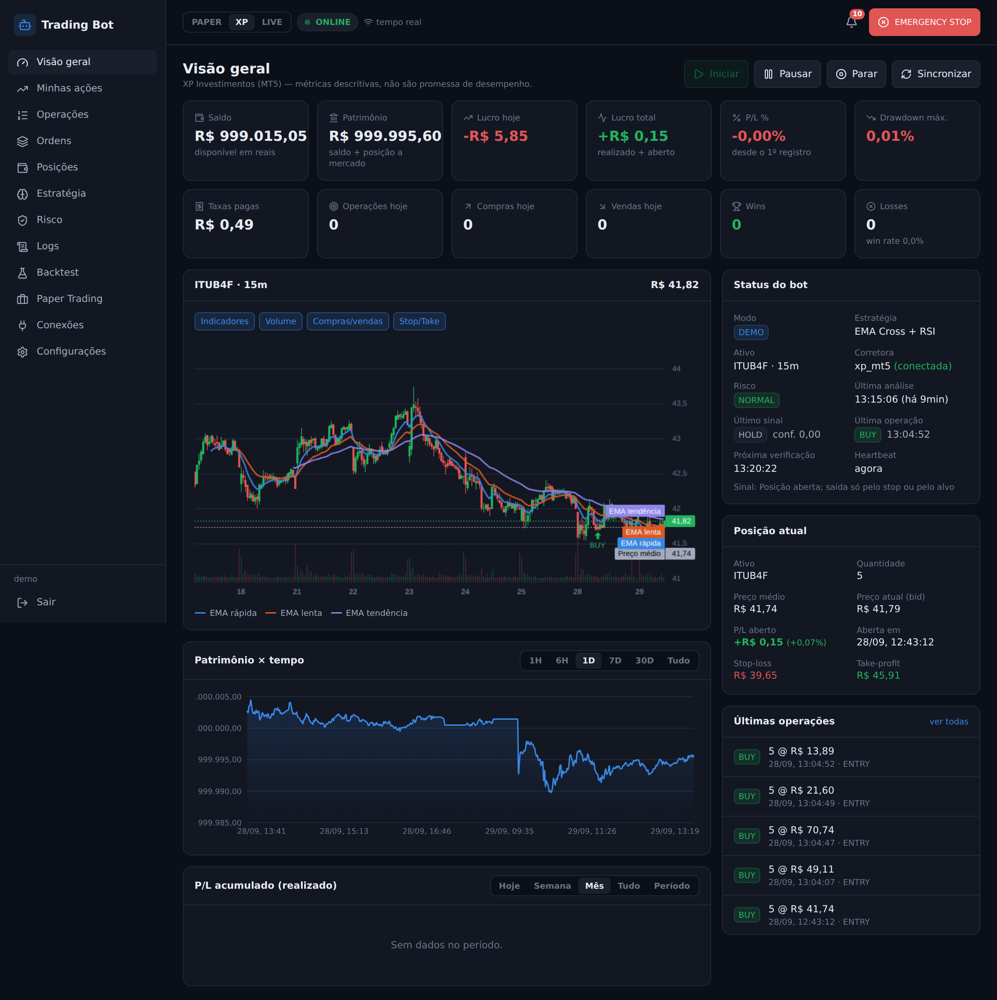
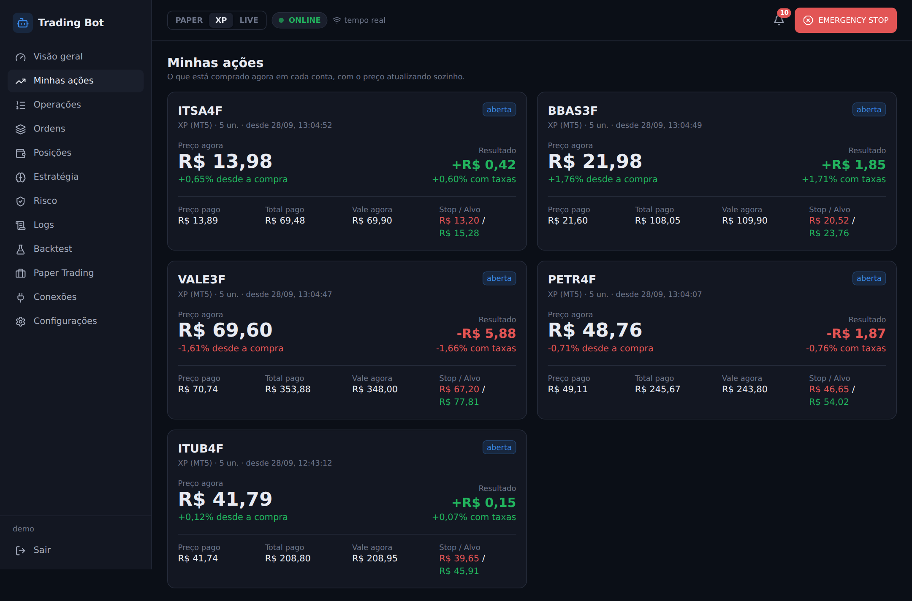
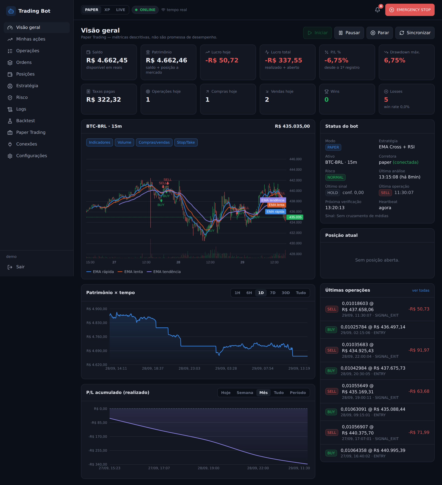
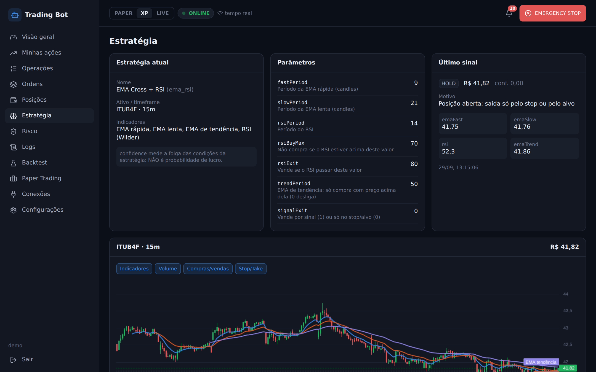
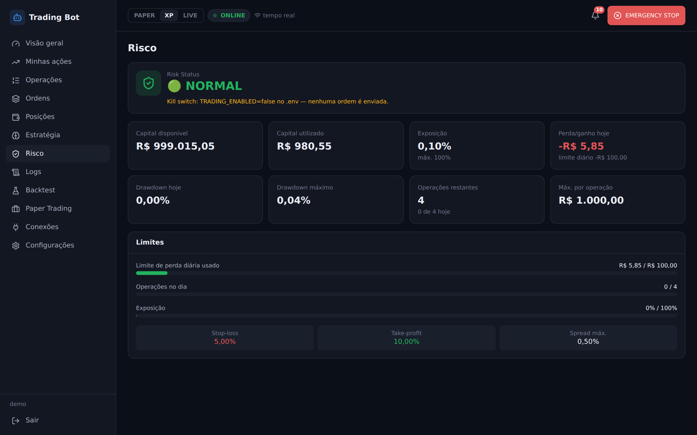
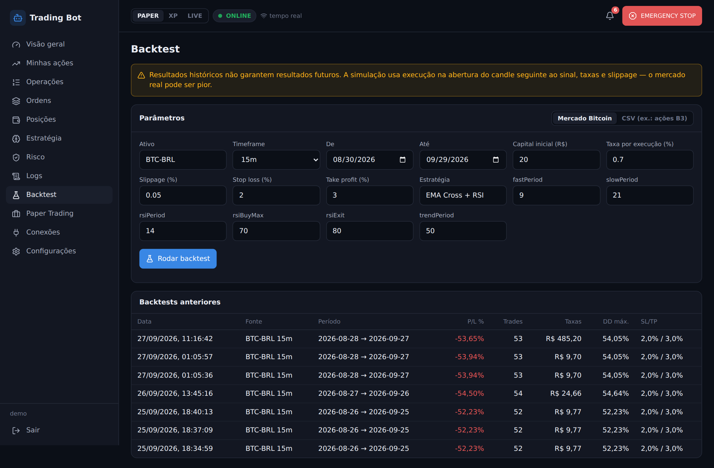
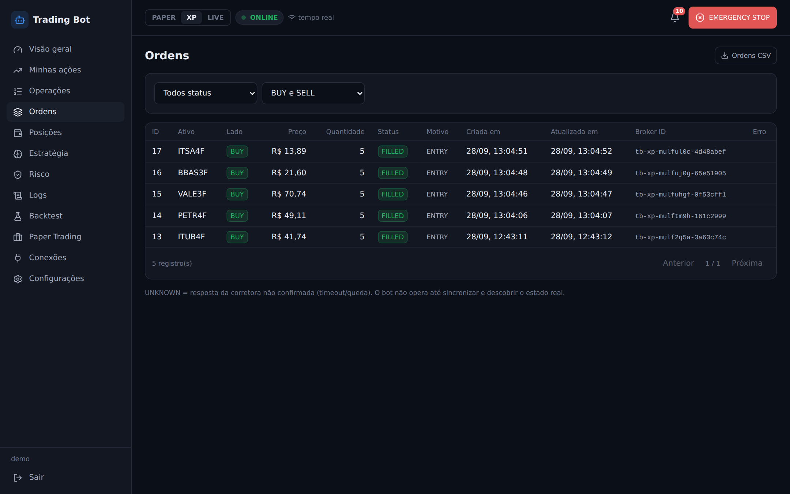
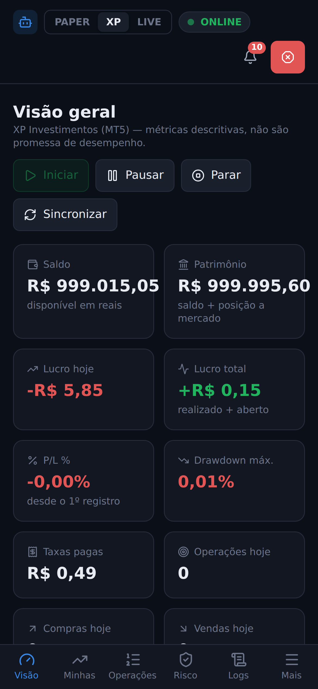
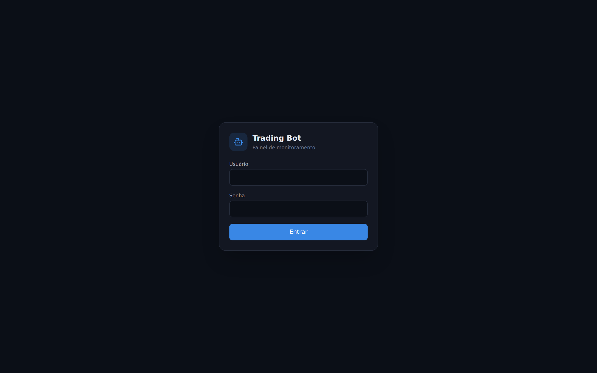

# Trading Bot — Bitcoin e ações da B3

[](https://github.com/Mhsilva-dev/trading-bot-showcase/actions/workflows/ci.yml)

Bot de trading automatizado com painel web em tempo real, **criado para uso pessoal**. Opera Bitcoin pela API do Mercado Bitcoin e ações fracionárias da B3 pela XP (MetaTrader 5), sempre começando em simulação: conta **paper** com preços reais, conta **demo** na corretora e só depois a conta real, com travas de segurança em cada etapa.

> Este repositório é uma vitrine do projeto. O sistema roda num servidor próprio e não está aberto ao público. Os valores nas imagens vêm da conta simulada (paper) e da conta demo da XP, ou seja, dinheiro fictício.


<p align="center">
  
</p>

## Telas

| Carteira de ações (XP demo) | Bitcoin (paper trading) |
|---|---|
|  |  |

| Estratégia e sinais | Gestão de risco |
|---|---|
|  |  |

| Backtest | Ordens |
|---|---|
|  |  |

<p align="center">
  
  &nbsp;&nbsp;
  
</p>

## O que o projeto faz

**Três contas, uma engine**
- **Paper:** simulador próprio que usa preços reais, compra no *ask*, vende no *bid* e aplica taxa, slippage e os mínimos da corretora.
- **XP (MT5):** ações fracionárias da B3 via MetaTrader 5, com uma carteira de várias ações, cada uma com stop e alvo próprios.
- **Mercado Bitcoin (live):** API v4 com OAuth2. Fica bloqueada até que duas flags de configuração sejam ligadas de propósito.

**Estratégia e análise**
- EMA Cross + RSI com filtro de tendência, avaliada só em candle fechado (sem olhar o futuro).
- Estratégias plugáveis: basta implementar uma interface e registrar.
- Backtest com execução no candle seguinte, stop tratado de forma conservadora quando stop e alvo caem no mesmo candle, gaps e taxas. Aceita dados da API ou CSV (útil para ações da B3).

**Gestão de risco**
- Antes de cada ordem são feitas mais de 20 verificações: kill switch, perda diária, número de operações, spread, liquidez, profundidade do livro, idade dos dados, mercado aberto, mínimos da corretora e se o alvo cobre as taxas.
- Estados explícitos: `NORMAL`, `TRADE_BLOCKED`, `NO_TRADE` e `TRADING_HALTED`, sempre com o motivo registrado.
- **EMERGENCY STOP** que persiste depois de reiniciar e funciona até com o painel fora do ar.

**Execução segura**
- Anti-duplicidade: a intenção da ordem é gravada no banco **antes** do envio, com id único, e a ordem **nunca** é reenviada automaticamente.
- Ordens com resposta ambígua (timeout, queda) viram `UNKNOWN`. Nesse caso o bot pausa, procura a ordem na corretora e só então volta a operar.
- Reconciliação periódica entre banco e corretora. Qualquer divergência pausa o trading.
- Retry com backoff exponencial, respeito a `Retry-After`, rate limit por endpoint e circuit breaker.

**Painel web**
- React com dark mode, pensado primeiro para o celular. Atualiza em tempo real por WebSocket e, se a conexão cair, passa a consultar a API.
- Gráfico de candles com EMAs, marcações de compra e venda e linhas de stop e alvo; curva de patrimônio; P/L acumulado.
- Telas de operações, ordens, posições, estratégia, risco, logs, backtest e configurações, com exportação em CSV.

**Segurança**
- Senhas com bcrypt e bloqueio após tentativas erradas, sessão em cookie `httpOnly`/`SameSite=strict`, proteção CSRF e verificação do `Origin`.
- Helmet com CSP restrita, validação de todas as entradas com zod (esquemas estritos) e CSV protegido contra injeção de fórmula.
- Credenciais da corretora cifradas com **AES-256-GCM**. A API nunca devolve a senha.
- O logger mascara chaves, tokens e senhas antes de gravar qualquer linha.

## Arquitetura

```
Market Data ─▶ Strategy ─▶ Risk Manager ─▶ Order Manager ─▶ Broker Adapter ─▶ Corretora
                                                  │                    ├─ PaperBroker (simulado)
                                                  ▼                    ├─ MercadoBitcoinBroker (REST)
                                          SQLite (WAL)                 └─ MT5BridgeBroker ─▶ EA MQL5 na XP
                                                  │
                                                  ▼
                                   Painel (Express + WebSocket + React)
```

- **Dois processos independentes no PM2.** O bot não expõe porta nenhuma; o painel só lê o banco e grava comandos numa fila. Se o painel cair, o bot continua; se o bot cair, o painel mostra OFFLINE.
- **Ponte MT5:** a XP só permite automação pelo MetaTrader 5, que é um programa de Windows. Por isso o MT5 roda no Linux via Wine, sem tela, com um robô (Expert Advisor) em MQL5 que conversa com o bot. Um processo liga e desliga o terminal no horário do pregão.
- **Máquina de estados por conta:** `UNKNOWN → PAUSE → SYNC → VERIFY → RESUME`. O bot nunca opera a partir de um estado desconhecido.

```
src/
├── bot/          engine, estratégia, risco, execução, portfólio, reconciliação
├── broker/       adapters (Mercado Bitcoin, MT5) + cliente HTTP com retry e circuit breaker
├── paper/        simulador de corretora
├── backtest/     backtester e leitor de CSV
├── server/       Express, sessão, segurança, WebSocket
├── api/routes/   rotas REST
├── security/     cofre de credenciais (AES-256-GCM)
├── mt5/          launcher do MetaTrader 5 no horário do pregão
└── database/     schema versionado e repositório
mt5/              Expert Advisor MQL5 (ponte com a corretora)
web/              React + Vite + Tailwind + Recharts + lightweight-charts
test/             143 testes (node:test)
```

## Testes

```bash
npm test   # 143 testes
```

A suíte cobre os indicadores (com valores de referência), cada motivo de bloqueio do Risk Manager, o simulador, a anti-duplicidade de ordens, timeouts antes e depois do envio, execuções parciais, reinício do bot, banco indisponível, o broker com `fetch` simulado (OAuth2, 429, circuit breaker) e a API (login, CSRF, `Origin`, WebSocket autenticado).

## Rodando localmente

Requisitos: Node.js 20+.

```bash
npm install && npm --prefix web install
npm run web:build
cp .env.example .env            # por padrão: paper e kill switch ligado
npm run user:create -- admin
npm run start:dashboard         # painel em http://127.0.0.1:3010
npm run bot:paper               # bot em modo simulado
```

A documentação completa (variáveis de ambiente, API, banco de dados, deploy, troubleshooting) está em [docs/documentacao-tecnica.md](docs/documentacao-tecnica.md).

## Sobre resultados

O foco do projeto é **engenharia de execução e segurança**, não prometer lucro. Os backtests com a estratégia padrão mostraram que as taxas por operação consomem o capital em timeframes curtos. Esse resultado está documentado e foi o que orientou os ajustes seguintes (timeframe maior e saída só por stop ou alvo). Nenhum resultado passado garante resultado futuro.

## Autor

Desenvolvido por **Matheus Henrique Fonseca Silva** — [GitHub](https://github.com/Mhsilva-dev) · [LinkedIn](https://www.linkedin.com/in/matheus-silva-01b8b3433)
